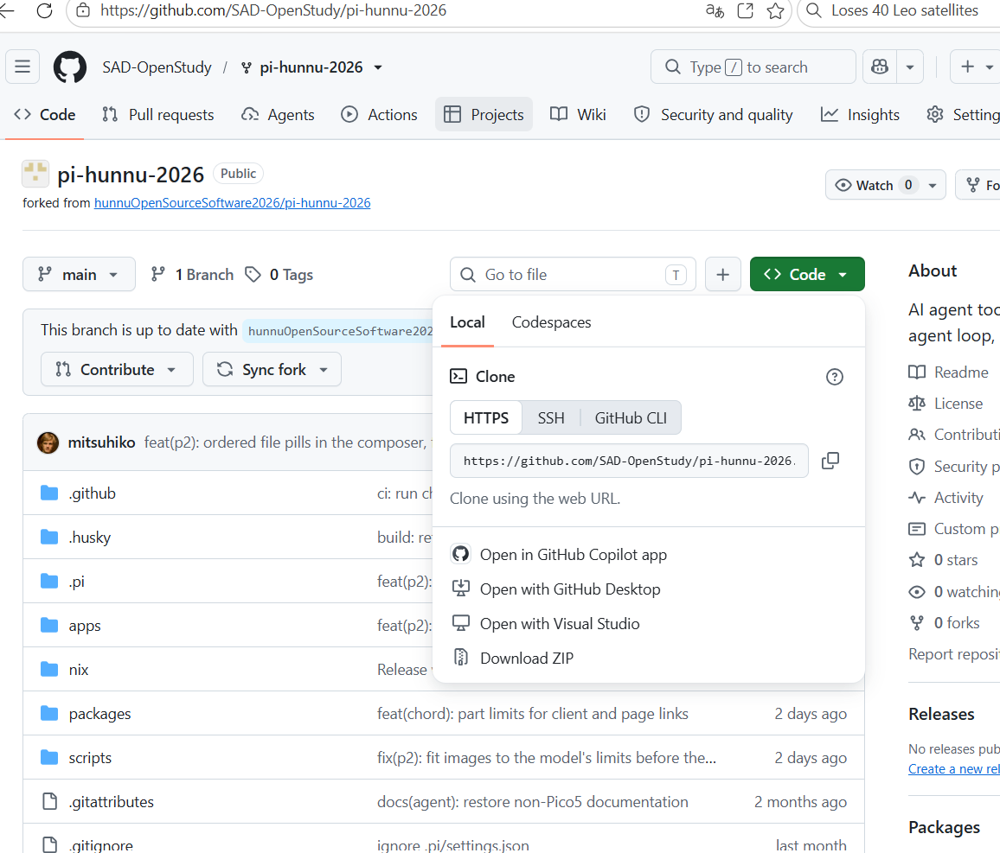
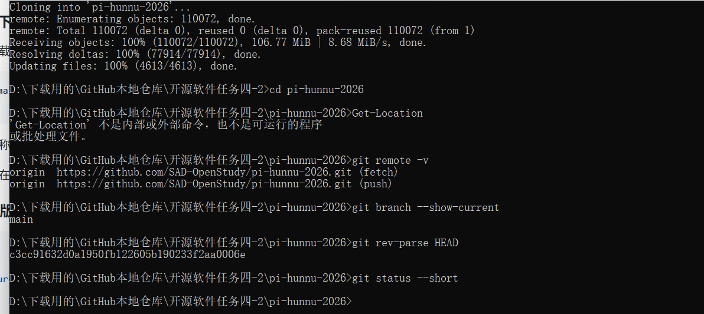
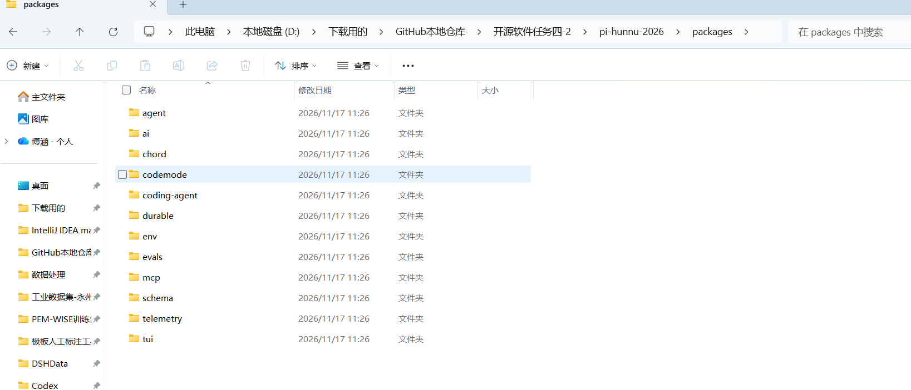
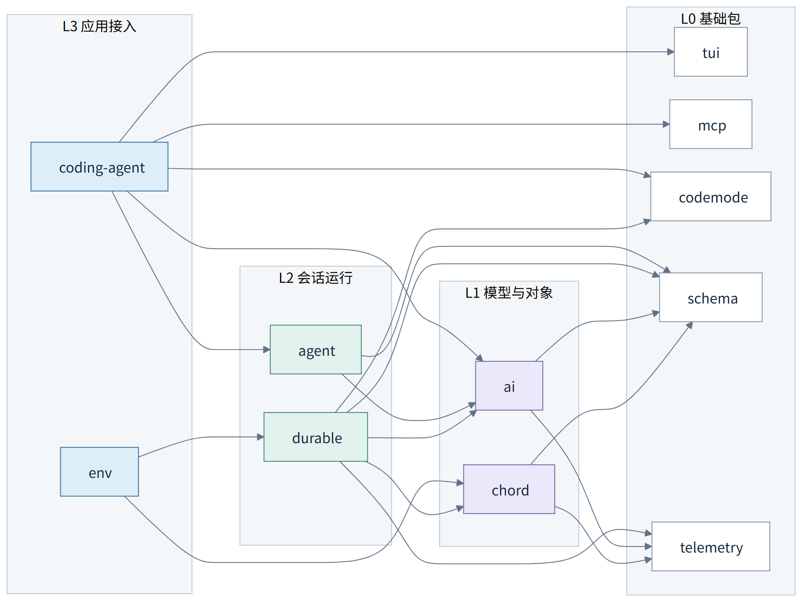

# 实践课 2　Pi Agent 源码阅读

liaobohan（Ottor1）

## 1. 源码获取

源码从小组仓库的 `main` 分支克隆。[SAD-OpenStudy/pi-hunnu-2026](https://github.com/SAD-OpenStudy/pi-hunnu-2026)

完整提交编号 [`c3cc91632d0a1950fb122605b190233f2aa0006e`](https://github.com/SAD-OpenStudy/pi-hunnu-2026/tree/c3cc91632d0a1950fb122605b190233f2aa0006e)

**小组仓库截图**



**S1 本地 Git 信息**



**本地源码目录截图**



## 2. 构建顺序和模块

在根目录执行 `npm run build` 时，实际顺序如下。[构建脚本](https://github.com/SAD-OpenStudy/pi-hunnu-2026/blob/c3cc91632d0a1950fb122605b190233f2aa0006e/package.json#L15)

```text
telemetry, schema, chord, tui, codemode, mcp,
ai, durable, env, agent, coding-agent
```

`packages/` 里还有一个 `evals`，由 `npm run eval` 单独调用。表中的构建命令和依赖来自各包的 `package.json`。常规 `tsc` 构建把 JavaScript 和类型声明放到 `dist/`。最后一列的路径从各包目录算起。

| 模块 | 做什么 | 构建与产物 | 直接内部依赖 | 源码位置 |
| --- | --- | --- | --- | --- |
| `telemetry` | 记录跟踪信息和运行指标 | `tsc` 生成 `dist/memory.js` 等 | 无 | `src/memory.ts` |
| `schema` | 定义 JSON Schema，检查输入是否符合要求 | `tsc` 生成 `dist/validator.js` 等 | 无 | `src/validator.ts` |
| `chord` | 管理跨进程对象、引用和持久化文档 | `tsc` 生成 `dist/host/host.js` 等 | `schema`、`telemetry` | `src/host/host.ts` |
| `tui` | 提供终端编辑器和列表，按变化的行刷新界面 | `tsc` 生成 `dist/tui-main-screen.js` 等 | 无 | `src/tui-main-screen.ts` |
| `codemode` | 用 QuickJS 跑模型生成的 JavaScript，可调用宿主提供的工具 | `tsc` 生成 `dist/runtime/worker.js` 等 | 无 | `src/runtime/host.ts` |
| `mcp` | 连接 MCP 服务，列出工具并发起调用 | `tsc` 生成 `dist/client.js` 和传输模块 | 无 | `src/client.ts` |
| `ai` | 统一不同模型提供商的流式接口 | 生成并检查模型数据，再用 `tsc` 编译，将 JSON 复制到 `dist/providers/data/` | `schema`、`telemetry` | `catalog/generate.ts`、`src/models.ts` |
| `durable` | 保存对话、工具结果和任务状态 | `tsc` 生成 `dist/harness/` 和 `dist/session/` 下的代码 | `chord`、`ai`、`codemode`、`schema`、`telemetry` | `src/harness/harness.ts` |
| `env` | 把文件和进程操作交给远端守护程序 | `tsc` 生成 `dist/remote-env.js` 等。守护程序由 `build:daemon` 单独构建 | `chord`、`durable` | `src/remote-env.ts` |
| `agent` | 管理消息，循环请求模型和执行工具 | `tsc` 生成 `dist/agent.js` 和 `dist/agent-loop.js` | `ai`、`schema` | `src/agent-loop.ts` |
| `coding-agent` | 把会话、终端界面和工具组装成 `pi` 命令 | 先编译并复制主题等资源，再用 esbuild 打包到 `dist/bundle/` | `agent`、`ai`、`codemode`、`mcp`、`tui` | `src/main.ts`、`src/core/sdk.ts` |

## 3. 依赖图

箭头从使用方指向被依赖方。没有内部依赖的包放在 L0，其余包按到 L0 的最长依赖路径分层。图中的 18 条边都来自各包的 `dependencies`。



[Mermaid 图源](assets/module-dependencies.mmd)

## 4. 三个问题

**1. 根目录和子模块分别怎么构建？**

在根目录，npm 按根 `package.json` 的 `build` 脚本依次构建各包。进入子模块后，npm 执行该包 `package.json` 里的构建命令。`tsc` 读取包内的 `tsconfig.build.json`，这个文件继承根目录的 `tsconfig.base.json`。

**2. 构建顺序和依赖有什么关系？**

先构建被依赖的包。例如 `coding-agent` 编译时要用 `../agent/dist/index.d.ts`，所以先构建 `agent`。第 9 步的 `env` 和第 10 步的 `agent` 在脚本里挨着，两者没有直接依赖。

**3. 依赖路径上的模块怎么分工？**

这次主要看了 `coding-agent → agent → ai`。比如在 Pi 里让助手读 `README.md`，`coding-agent` 先建会话，`agent` 把消息交给 `ai`，由 `ai` 跟模型通信。如果模型要求读文件，`agent` 就调用读取工具，再把结果交回模型。
